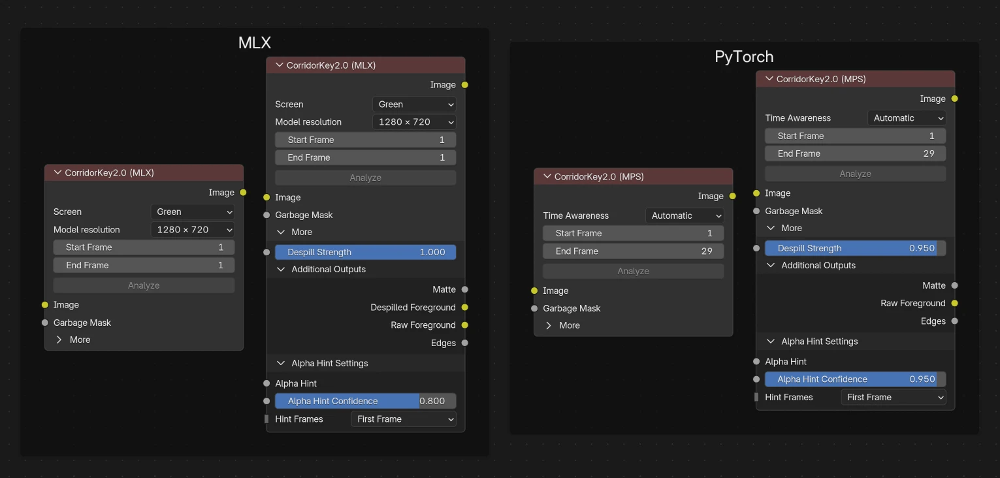

# CorridorKey2.0 Blender Add-On

### important stuff
  
This is a blender add-on integration of [CorridorKey2.0](https://github.com/nikopueringer/CorridorKey2.0) by Niko Pueringer, though not affiliated with him.   
This extension was made using AI, if you want to stay away from anything related to it, I totally understand.

Apple Silicon is supported and tested, using a [MLX port](https://github.com/peterteravskis/corridorkey-v2-mlx) by Peter Teravskis.\
[-> Download for Apple Silicon](UNZIPME.zip?raw=true)

Windows/Nvidea is experimental and still untested (please test):\
[-> Download experimental, windows/nvidia extension ](experimentalNVIDIA0.3.x/corridorkey_compositor-0.3.18-experimental.3.zip?raw=true)\
[more info](experimentalNVIDIA0.3.x/README.md)

Also see the [experimental MPS build](0.5.xMPS/README.md) (at the moment not very performant).\ [Performance measurements](performance.md) record local timings and memory use.

### specifics

The extension gives you a node in the compositor in which you can plug a video sequence and after an analysis it outputs the keyed result as well as a mask.   
To use it, install the extension, then under the add-on preferences download the backend.  
  
At the moment this officially only works on an apple silicon mac as that is what I’m working with, although it should be pretty easy to swap out the backend for something else, see above for experimental windows/nvidea support.  
I want to improve this further (see roadmap below), including more/better mac implementations upstream and supporting more platforms (although I can’t test that so contribution are welcome) but feel free to take anything and do what you want with it. I only wanted to use this amazing keyer in blender, I’m also happy if someone else does a better job.  
  
This repository only hosts the blender add-on framework and workings, the actual key is hosted elsewhere and has to be downloaded separately (the extension can do it for you).  

Roadmap:
- test on a device that isn't mine
- make model selection regarding resolution and quality clearer
- make it easier to add/download and remove/delete a model in settings
- integrate fullHD and other improved upstream models (they don't exist currently)
- investigate integrated hint and using apple vision
- investigate performance, especially in the first two steps

Some notes from the designer:

I really want the image input to be inline with the image output but that's not possible for python extension, only for blender internal ones. Similarly the dropdown would maybe be better placed ontop but again same story (I believe).\
The biggest annoyance by far is that extension nodes such as this one don't show up in the list when dragging from a socket and releasing.\

I'd love to release this on the blender extensions platform but due to licensing conflicts and external code downloading/running, this probably won't happen.\
I will consider this project pre-1.0.0 as long as it is not feature complete and largely untested.
